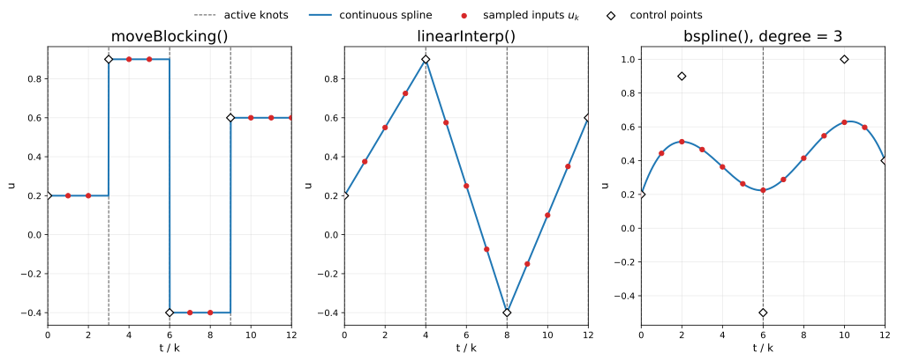
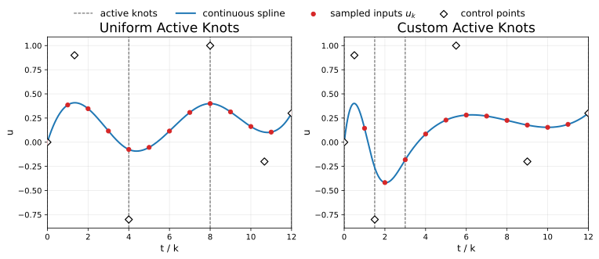

# Input Parameterization

## Motivation

We parameterize the input trajectory with a B-spline, which reduces the number of design variables in the MPC optimization.
For a fixed number of control points, the number of design variables contributed by the input trajectory is independent of the horizon length.

This can significantly reduce solve time for long horizons.
There is still computational cost in lengthening the horizon,
since the model must still be propagated across all horizon steps,
but the optimization search space can be much smaller than it would be without parameterization.

For example, a non-parameterized horizon with $T = 100$ steps and input dimension $m = 4$ yields at least $mT = 400$ input design variables.
If the same horizon is parameterized with only $\eta = 5$ control points,
that number drops to $m\eta = 20$.

Parameterization constrains how the input can vary over time, so the optimizer is solving over a smaller and more structured family of trajectories.
That is not necessarily a drawback.
B-splines are built from continuous polynomial segments, so they can produce smoother input trajectories and may reduce or eliminate the need for explicit slew-rate constraints in some applications.

This page gives the mathematical definition of the parameterization,
its sampled matrix form,
and the API-level factory methods provided by `Parameterization`.
Other bases, such as Laguerre functions, can be used through a sampled basis matrix (see [Custom Bases](#custom-bases)).

--8<-- "concepts/nomenclature.md"

## B-Splines

B-splines are continuous in nature, but the MPC input trajectory $\{\mathbf{u}_k\}_{k=0}^{T-1}$ is discrete.
We therefore define a spline over the interval $t \in [0, T-1]$ and evaluate it at the integer horizon indices.
The parameterized input trajectory is given by

$$
\mathbf{u}_k = \sum_{i=0}^{\eta-1}  \mathbf{c}_i \, b_i^p(k, \boldsymbol{\tau}),
$$

where $\boldsymbol{\tau}$ is a non-decreasing knot vector.
The spline is valid on the active interval $[\tau_p, \tau_{\mu-p-1}]$.
These two knots are called the boundary knots,
while the knots between them (excluding the boundary knots) are called interior knots.
We refer to the set of boundary and interior knots as the active knots since the valid evaluation interval includes the boundaries.
For MPC, we match the boundary knots with the boundary horizon indices so that the spline is defined at each horizon index $k$:

$$
\tau_p = 0,
\qquad
\tau_{\mu-p-1} = T-1.
$$

The basis functions are defined by the Cox-de Boor recursion formula.

For $p=0$

$$
b_i^0(k, \boldsymbol{\tau}) =
\begin{cases}
1 & \tau_i \le k < \tau_{i+1}, \\
0 & \text{otherwise},
\end{cases}
$$

and for $p>0$

$$
b_i^p(k, \boldsymbol{\tau}) =
\frac{k - \tau_i}{\tau_{i+p} - \tau_i} b_i^{p-1}(k, \boldsymbol{\tau})
+ \frac{\tau_{i+p+1} - k}{\tau_{i+p+1} - \tau_{i+1}} b_{i+1}^{p-1}(k, \boldsymbol{\tau}),
$$

with the convention that terms with zero denominators are treated as zero.

### Matrix Representation

The B-spline basis functions can be represented as a matrix $\Psi$ to conveniently convert from a stacked vector of
control points to a stacked input trajectory:

$$
\mathbf{u} = \Psi^p(\boldsymbol{\tau}) \, \mathbf{c}.
$$

What is especially convenient about the matrix representation is that the matrix is constant for a given degree and knot vector.
This library fixes the degree and knot vector upon construction of an MPC object, so the weights in $\Psi$ are computed once at construction and stored for faster evaluation.
This matrix form is the bridge from spline parameterization to the QP derivation.
The next concepts page uses it to write the predicted state trajectory and cost in quadratic form.

## Provided Factory Methods


Comparison of the built-in parameterization factory methods for the same horizon and similar control-point values.
`moveBlocking()` produces piecewise-constant inputs,
`linearInterp()` produces piecewise-linear inputs,
and higher-degree `bspline()` produces smoother trajectories.
In all three cases, the optimizer chooses control points,
and the dense MPC input trajectory is obtained by evaluating the parameterization at the integer horizon indices.

### Move-Blocking

Move-blocking holds the input constant over the intervals between the change points.
It is the degree-zero special case of the B-spline framework.
The `Parameterization` class provides `moveBlocking()` for this purpose.

The two overloads are:

=== "Python"

    ```python
    param = Parameterization.moveBlocking(horizon_steps, num_control_points)
    param = Parameterization.moveBlocking(horizon_steps, change_points)
    ```

=== "C++"

    ```cpp
    auto param = Parameterization::moveBlocking(horizon_steps, num_control_points)
    auto param = Parameterization::moveBlocking(horizon_steps, change_points)
    ```

The first creates a uniform parameterization with equally sized blocks.
The second uses explicitly specified change points and therefore allows variable block widths.
The first change point must be $0$ and the minimum number of change points is 1, where the input trajectory would be constant.
When using the move-blocking factory method, the right boundary knot is internally appended to the list of change points to create the full knot vector.
The change points are the start indices of the blocks, so each one may be any sample from $0$ to $T-1$.
For example, `moveBlocking(10, [0, 1, 2])` gives one free input for each of the first three steps and holds the third until the end of the horizon, and change points $0, 1, \dots, T-1$ give one free input per step.

### Linear Interpolation

Linear interpolation is the degree-one special case.
The input becomes piecewise linear over the horizon.
The `Parameterization` class provides `linearInterp()` for this purpose.

The two overloads are:

=== "Python"

    ```python
    param = Parameterization.linearInterp(horizon_steps, num_control_points)
    param = Parameterization.linearInterp(horizon_steps, endpoints)
    ```

=== "C++"

    ```cpp
    auto param = Parameterization::linearInterp(horizon_steps, num_control_points)
    auto param = Parameterization::linearInterp(horizon_steps, endpoints)
    ```

The first creates equally spaced segment endpoints.
The second accepts custom endpoints, which allows variable segment lengths.
The first endpoint must be $0$ and the last $T-1$ to properly set the boundary knots.
The minimum number of endpoints is 2, being the boundaries of a single line segment.

### Clamped B-Spline

The general `bspline()` factory method creates clamped B-splines of the specified degree.
In the full knot vector, the first and last knots have multiplicity $p+1$, so the trajectory starts at the first control point and ends at the last.

The two overloads are:

=== "Python"

    ```python
    param = Parameterization.bspline(horizon_steps, degree, num_control_points)
    param = Parameterization.bspline(horizon_steps, degree, active_knots)
    ```

=== "C++"

    ```cpp
    auto param = Parameterization::bspline(horizon_steps, degree, num_control_points)
    auto param = Parameterization::bspline(horizon_steps, degree, active_knots)
    ```

The first creates a uniform clamped spline.
The second accepts custom active knots, which allows nonuniform knot spacing.
The active knot vector must include at least the two boundary entries $0$ and $T-1$ so that the spline is valid over the MPC horizon.
Boundary knots within $10^{-9} T$ of $0$ or $T-1$ (round-off from computing the knots) are snapped to those values.

### Geometric Knots

The factories that take a number of control points (`moveBlocking()`, `linearInterp()`, and `bspline()`) accept an optional `knot_ratio` $g > 0$.
The knot intervals then have lengths proportional to $1, g, g^2, \dots$, scaled so the active knots span $[0, T-1]$.

=== "Python"

    ```python
    param = Parameterization.bspline(horizon_steps, degree, num_control_points, knot_ratio=1.5)
    param = Parameterization.moveBlocking(horizon_steps, num_control_points, knot_ratio=1.5)
    ```

=== "C++"

    ```cpp
    auto param = Parameterization::bspline(horizon_steps, degree, num_control_points, 1.5)
    auto param = Parameterization::moveBlocking(horizon_steps, num_control_points, 1.5)
    ```

With $g > 1$, the short intervals (and so the most flexibility) are at the start of the horizon, whose inputs are applied first, and the long intervals are at the end.
$g < 1$ does the opposite, and the default $g = 1$ gives uniform knots.
With `moveBlocking()`, this gives geometric move blocking.
A good ratio depends on the horizon, the number of control points, and the system; compare a few values in closed loop, as when choosing the number of control points.
Intervals shorter than one sample are fine as long as the sampled basis keeps full column rank (see [Accepted Knot Vectors](#accepted-knot-vectors)).
Otherwise the factory throws and suggests a ratio closer to 1 or fewer control points, which limits $g$ for a given horizon and number of control points.
`makeClampedKnots(horizon_steps, degree, num_control_points, knot_ratio)` returns the same knot vector, as a starting point for custom knots.

## Tradeoffs and Interpretation

### Number of Control Points $\eta$

- Smaller $\eta$ reduces the optimization dimension and can significantly improve solve time.
- Larger $\eta$ gives the optimizer more freedom to shape the input trajectory.

### Degree $p$

- Lower degree gives a more local and less smooth trajectory representation.
- Higher degree gives smoother trajectories and broader basis support, but can somewhat flatten the input trajectory if
  the control points are saturated by the input limits since splines generally do not pass through control points.
  This can be remedied by saturating the evaluated input trajectory instead (when $p>1$, or $p=1$ with non-integer knots).

### Knot Placement


Effect of active-knot placement on the same clamped spline degree and control-point values.
Changing the active-knot locations redistributes where the trajectory can vary more rapidly.

- Uniform knots distribute flexibility evenly across the horizon.
- Custom knots or change points concentrate flexibility where it is most needed.

### Accepted Knot Vectors

The sampled basis $\Psi$ ($T \times \eta$) must have full column rank.
Otherwise some combination of control points has no effect on any sampled input, the cost is flat in that direction, and the QP has no unique solution.
By the Schoenberg-Whitney theorem, $\Psi$ has full column rank if and only if every control point $j$ can be given its own sample $k_j$, with $k_0 < k_1 < \dots < k_{\eta-1}$, at which its basis function is nonzero, $b_j^p(k_j, \boldsymbol{\tau}) \neq 0$.
Construction checks this condition exactly on the sampled basis and throws `std::invalid_argument` (`ValueError` in Python) otherwise; the message names the first control point without a sample, its support, and the samples it would need.

- Knots do not have to be integers or at least one sample apart.
  For example, geometric knots whose first interval is shorter than one sample are accepted as long as every control point still gets its own sample.
- Repeated knots are allowed.
  Each repeat lowers the continuity of the input at that knot by one, so a double knot in a quadratic spline gives a kink and multiplicity $p+1$ gives a jump, which can be what you want (e.g., a planned step in the input).
  For example, `linearInterp(5, [0, 2, 2, 4])` is piecewise linear with a jump at $k = 2$.
  With `InputBoundMode::Exact` and $p = 1$, the samples on both sides of a repeated knot are bounded.
- A basis function that is zero at every sample is rejected.
  For example, in `bspline(10, 1, [0, 3.2, 3.21, 3.22, 9])` control point 2 is only nonzero on $(3.2, 3.22)$, a knot multiplicity above $p+1$ leaves a basis function supported on a single point, and with move blocking every block $[\tau_i, \tau_{i+1})$ must contain an integer.
- Basis functions that are each nonzero somewhere but share too few samples are rejected too.
  For example, in `bspline(10, 1, [0, 2, 3.5, 3.9, 4.2, 4.6, 9])` the hat functions of control points 3 and 4 are both nonzero only at $k = 4$.
- An interior knot equal to the first active knot $0$, or for $p > 0$ to the last active knot $T-1$, is rejected.
  The spline is evaluated from the right at $0$ and from the left at $T-1$, so that basis function is zero at every sample.
  For $p = 0$, a change point at $T-1$ is a valid one-sample block.

Near-coincident knots pass this check, since the rank is still full, but they make the QP ill conditioned.
Clustered or very short knot intervals make the QP worse conditioned in general, because nearby control points affect almost the same samples, and the condition number can grow by orders of magnitude compared with uniform or geometric knots.
OSQP then needs more iterations and may stop at `MaxIterReached`.
A small input weight `R` (with `input_cost`) improves the conditioning, as does spreading the knots.

Parameterization is therefore both a dimensionality-reduction tool and a way to shape the family of trajectories the optimizer may select.

## Input Bounds

The input limits $\mathbf{u}_{\min} \le \mathbf{u}_k \le \mathbf{u}_{\max}$ are always enforced, and `Options::input_bounds` (`Options.input_bounds` in Python) chooses the constraint rows that enforce them (see [Input Trajectory Saturation Constraint](problem-formulation.md#input-trajectory-saturation-constraint)).

- `InputBoundMode::ControlPoints` (the default) bounds the control points, one row per control point.
  B-spline basis functions are non-negative and sum to one, so every sampled input is a convex combination of control points and stays inside the limits (the convex hull property).
  For $p \ge 2$, and for $p = 1$ with non-integer knots, the spline does not pass through its control points, so whenever the input changes the bound keeps the sampled inputs away from the limits and part of the input range is unusable.
- `InputBoundMode::Exact` bounds the sampled inputs.
  For $p = 1$ only the samples next to each knot are needed (at most $2\eta - 2$ rows per input), but for $p \ge 2$ every sample is bounded ($T$ rows per input), which can make OSQP slower and less reliable on long horizons.
- `InputBoundMode::Refined` bounds the control points of the same spline after knot insertion, described below.
  It uses much of the range that `ControlPoints` loses, with far fewer rows than `Exact`.

### Refined Bounds

Inserting a knot changes the knot vector and the control points of a B-spline but not the spline itself: the new control points are fixed convex combinations of the old ones (Boehm's knot insertion, or the Oslo algorithm for many knots at once).
Per input channel, the refined control points are $\Gamma \mathbf{c}$, where $\Gamma$ depends only on the knots and is banded (each refined control point combines at most $p+1$ consecutive control points).
The refined control points lie closer to the spline and converge to it as the knot intervals shrink, so bounding them is tighter than bounding the original control points, while every sampled input still stays inside the limits by the convex hull property of the refined spline.

`Refined` splits every active knot interval into $\max(2, \lceil \ell / L \rceil)$ equal parts, where $\ell$ is its length and $L$ is `refined_bound_interval` (`Options::refined_bound_interval`, default 16), so every interval is split at least once and none is longer than $L$ samples.
It then bounds the refined control points that some sample depends on, about $\max(T / L, 2(\eta - p)) + p$ rows per input.
If that is not fewer than the $T$ rows of `Exact` (short horizons or a very small $L$), `Refined` uses the `Exact` rows instead, which are exact and fewer; this is decided once at construction.
For example, a quadratic spline with $T = 500$ and $\eta = 10$ uniform control points has knot intervals of about 62 samples, so $L = 16$ splits each into 4 and bounds 34 refined control points per input, against 10 rows for `ControlPoints` and 500 for `Exact`.
$\Gamma$ is computed once at construction, so the refined rows add no work to updates or solves beyond their number.

A smaller $L$ bounds the sampled inputs more tightly with more rows.
Very small values approach the row count of `Exact` (and fall back to its rows), and many nearly parallel rows can make OSQP need many more iterations, as with `Exact`.
Because every interval is split at least once, `Refined` is tighter than `ControlPoints` even on short horizons whose knot intervals are all at most $L$ samples long.
The bound holds for the continuous spline, not only at the samples, so it stays slightly conservative compared with `Exact`.

Degrees 0 and 1 already have exact bounds with few rows, so `Refined` uses them: for $p = 0$ it is the same as `ControlPoints` (the control points are the sampled inputs), and for $p = 1$ the same as `Exact` (the samples next to each knot).
A [custom basis](#custom-bases) always bounds every sampled input, whatever the mode.

## Custom Bases

`fromBasis()` takes any basis sampled at $k = 0, \dots, T-1$ as a $T \times \eta$ matrix $\Psi$ with one column per coefficient, so $\mathbf{u}_k = \sum_i \Psi_{k,i} \mathbf{c}_i$, where the coefficients $\mathbf{c}_i$ take the place of the control points.

=== "Python"

    ```python
    param = Parameterization.fromBasis(horizon_steps, basis)  # basis.shape == (horizon_steps, num_control_points)
    ```

=== "C++"

    ```cpp
    auto param = Parameterization::fromBasis(horizon_steps, basis)  // Eigen::MatrixXd, horizon_steps x num_control_points
    ```

The basis must have finite entries and full column rank, tested by its singular values: the smallest must exceed $10^{-9}$ times the largest.
Full rank does not make the QP well conditioned, since the condition number of the QP Hessian grows like the square of that of $\Psi$.
For example, many Laguerre functions with a pole close to 1 pass the rank test, yet can make the QP so badly conditioned that OSQP fails to converge.
Orthonormalizing the columns (e.g. `numpy.linalg.qr`) spans the same input trajectories and improves the conditioning by many orders of magnitude.
B-splines are well conditioned without this, and orthonormalizing would destroy their banded structure and their convex hull property.

A custom basis has `type` `Custom`, `degree` $-1$, and empty `knots`, and it is treated as dense: every coefficient can affect every sample, so the QP rows of each sampled input involve every coefficient.
B-spline properties that the MPC relies on do not hold, which changes three features:

- **Input limits.**
  B-spline basis functions are non-negative and sum to one, so bounding the control points bounds every sampled input (the convex hull property), and `InputBoundMode::Exact` is optional.
  A custom basis has no such property, so the MPC always bounds every sampled input ($T$ constraint rows per input channel), whatever `input_bounds` is.
- **Input cost.**
  With `InputCostMode::ControlPoints`, `R` weights the coefficients, $\sum_i (\mathbf{c}_i - \mathbf{c}_{\mathrm{ref},i})^\top R \, (\mathbf{c}_i - \mathbf{c}_{\mathrm{ref},i})$, not the sampled inputs.
  With orthonormal columns and a zero reference, $\lVert \Psi \mathbf{c} \rVert = \lVert \mathbf{c} \rVert$ for each channel, so this equals `R` on the sampled inputs summed over the horizon.
  No coefficients represent a constant input in general, so in this mode `setReferenceInput()` throws `std::logic_error` (`RuntimeError` in Python) for a custom basis; the coefficient reference defaults to zero, and `setReferenceInputControlPoints()` sets it directly.
  `InputCostMode::Trajectory` weights the sampled inputs for any basis, and accepts a constant reference (`setReferenceInput()`) or a sampled one (`setReferenceInputTrajectory()`); see [Input Cost](problem-formulation.md#input-cost).
- **Slew rates.**
  Differences of coefficients do not bound input changes, so `slew_control_points` throws `std::invalid_argument` (`ValueError` in Python) at construction.
  `slew_initial_input` still works, since it bounds the first sampled input.

The input rate cost (`use_input_rate_cost`) and the general constraints act on the sampled inputs, so they mean the same for a custom basis as for a B-spline.

The logger records the basis (`meta_basis`, row by row) instead of the degree and knots.

### Example: Laguerre Functions

Discrete Laguerre functions decay like $a^k$ for a pole $0 \le a < 1$, so a few of them can describe a long input transient.
Used directly, $\mathbf{u} = \Psi \mathbf{c}$, the predicted input decays to zero and can not hold the steady input that keeps a plant at a nonzero reference, so the direct form is not suited to setpoint tracking on its own.

The deviation form $\mathbf{u} = \mathbf{u}_{\mathrm{ss}} + \Psi \mathbf{c}$ plans the deviation from the steady-state input $\mathbf{u}_{\mathrm{ss}}$ that holds the reference, which enters through the model offset $\mathbf{w}$ (see [Deviation Form for Other Bases](modeling-patterns.md#deviation-form-for-other-bases) for the full recipe).
For the [mass-spring-damper example](../examples/mass-spring-damper.md), with the limits $0 \le u \le 4$:

```python
import numpy as np
import affine_mpc as ampc


def laguerre_basis(horizon_steps, num_functions, pole):
    """Discrete Laguerre functions (Wang, 2004): row k of the result is L(k)."""
    a, beta = pole, 1.0 - pole**2
    omega = np.zeros((num_functions, num_functions))
    for i in range(num_functions):
        omega[i, i] = a
        for j in range(i):
            omega[i, j] = beta * (-a) ** (i - j - 1)
    L = np.sqrt(beta) * (-a) ** np.arange(num_functions)
    basis = np.zeros((horizon_steps, num_functions))
    for k in range(horizon_steps):
        basis[k] = L
        L = omega @ L
    return basis


T, ts = 40, 0.1
basis, _ = np.linalg.qr(laguerre_basis(T, 4, 0.8))  # orthonormal columns
param = ampc.Parameterization.fromBasis(T, basis)
mpc = ampc.MPC(2, 1, param, ampc.Options(input_cost=ampc.InputCostMode.ControlPoints))

A = np.array([[0.0, 1.0], [-0.6, -0.1]])
B = np.array([0.0, 0.2])
w = np.zeros(2)
x_ref = np.array([1.0, 0.0])
u_min, u_max = np.array([0.0]), np.array([4.0])

# steady-state input that holds x_ref: 0 = A x_ref + B u_ss + w
u_ss = np.linalg.lstsq(B[:, None], -(A @ x_ref + w), rcond=None)[0]  # [3.0]

mpc.setModelContinuous2Discrete(A, B, w + B * u_ss[0], ts)  # offset w + B u_ss
mpc.setInputLimits(u_min - u_ss, u_max - u_ss)  # limits on u - u_ss
mpc.setWeights(np.array([1.0, 0.1]), np.array([1e-3]))  # R weights the coefficients
mpc.setReferenceState(x_ref)  # coefficient reference stays at zero
mpc.initializeSolver()

xk = np.zeros(2)
for _ in range(100):
    mpc.solve(xk)
    u_tilde = mpc.getNextInput()
    uk = u_ss + u_tilde  # input for the plant
    xk = mpc.propagateModel(xk, u_tilde)  # the model includes B u_ss
```

Without $\mathbf{u}_{\mathrm{ss}}$ (the direct form), the same controller settles at a position of about 0.87 instead of 1.
`examples/laguerre.py` runs both forms and compares their closed-loop cost (see [Laguerre Basis](../examples/laguerre.md)).
It also zeroes the rows of $\Psi$ that have decayed to round-off before the QR decomposition: those samples are frozen at $\mathbf{u}_{\mathrm{ss}}$ anyway (they can be many orders of magnitude below round-off for long horizons), and their tiny coefficients in the input bound rows would otherwise hurt OSQP's scaling.

## Next Step

The next step is to see how input parameterization affects the [QP Formulation](qp-formulation.md).
